<div align="center">

# ∞ Infradian

**See your cloud as a graph. Ask "what breaks if…?" before you change it. Turn the picture into Terraform.**

An infrastructure studio that combines a live dependency map, a change-impact simulator, and a
visual Terraform/OpenTofu designer — plus the full delivery platform (CI, GitOps, observability, SLOs) around it.


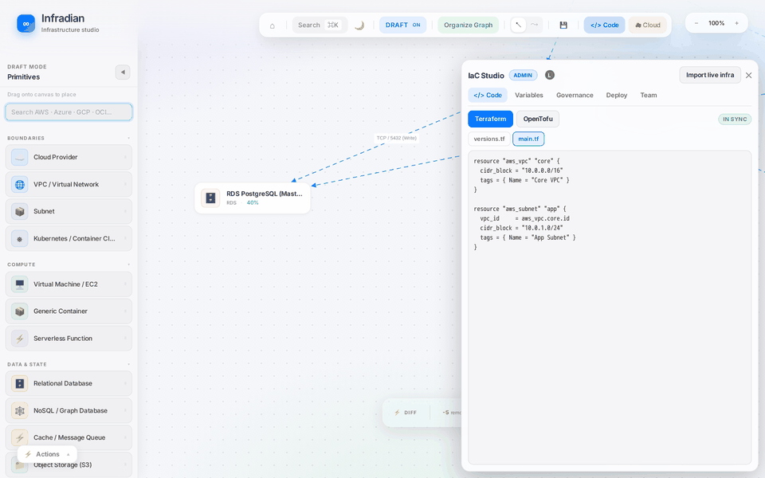

*Typing Terraform on the right — the architecture on the left updates live (and the reverse works too).*

</div>

> **No install needed to evaluate this project** — everything below is shown with real screenshots from the running app.
> The infrastructure shown is a bundled **demo dataset**, not a live cloud account (see [Honest notes](#honest-notes)).

---

## What it does

| | |
|---|---|
| 🗺️ **Understand** | Renders an infrastructure estate as an interactive dependency graph (VPCs, subnets, load balancers, clusters, databases) with live-style load metrics. |
| 💥 **Predict** | Click any resource to see its **blast radius**, whether it is **safe to delete**, and a **counterfactual simulation** of removing it — what breaks, what degrades, what survives. |
| ✏️ **Design** | Drag resources from **AWS, Azure, GCP and OCI** onto a draft canvas and get **Terraform / OpenTofu** generated in real time. |
| 🔁 **Round-trip** | Edit the code and the canvas updates; edit the canvas and the code updates. Import existing `.tf` from a Git repo. |
| 🛡️ **Govern** | Cost estimate, security guardrails and policy-as-code evaluated on every change; policy "deny" blocks apply. |
| 🚀 **Ship** | Run `validate / plan / apply` in Docker, commit to Git, collaborate live with roles (viewer → admin). No destroy button, by design. |

## Screenshots

### Dependency map & impact analysis
<p align="center">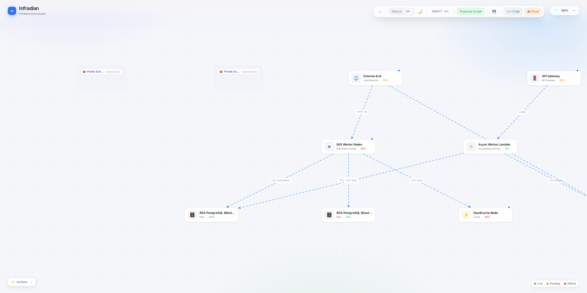 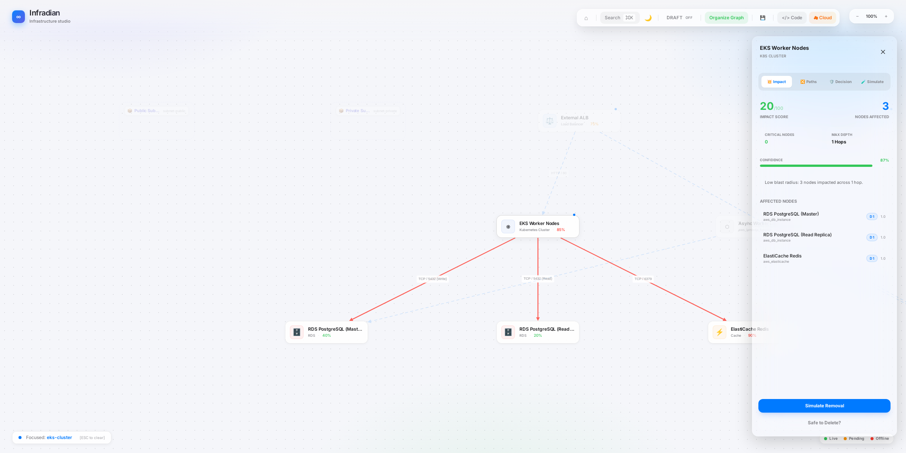</p>
<p align="center"><em>Left: the demo estate. Right: selecting <code>EKS Worker Nodes</code> highlights its blast radius (3 nodes, 1 hop) and scores the impact.</em></p>

### Multi-cloud designer → Terraform
<p align="center">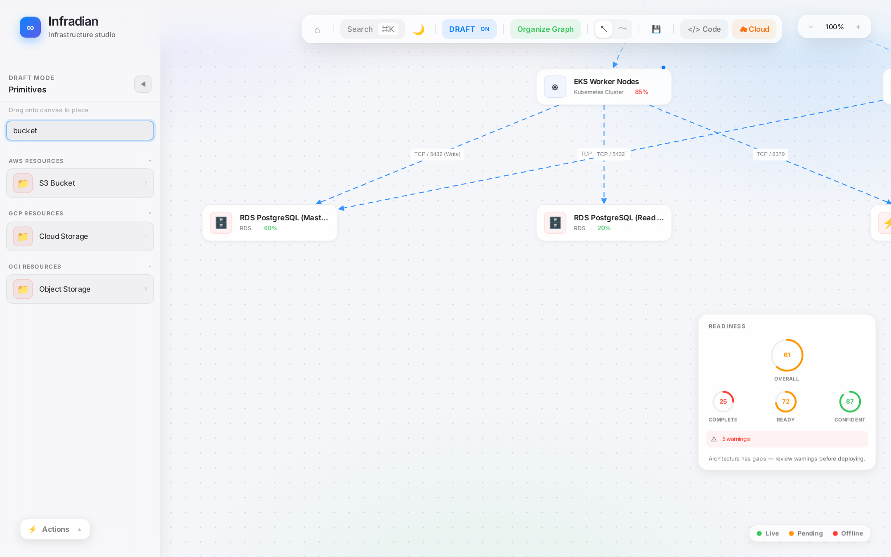 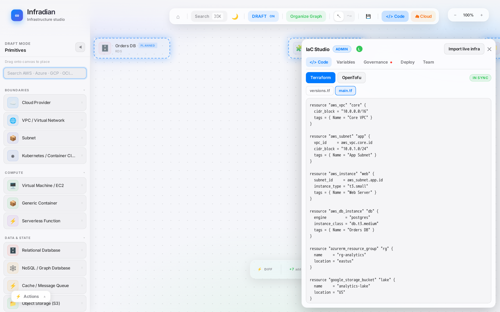</p>
<p align="center"><em>Searchable AWS/Azure/GCP/OCI palette; generated, valid Terraform with real resource references.</em></p>

### Governance, variables, deploy, team
<p align="center">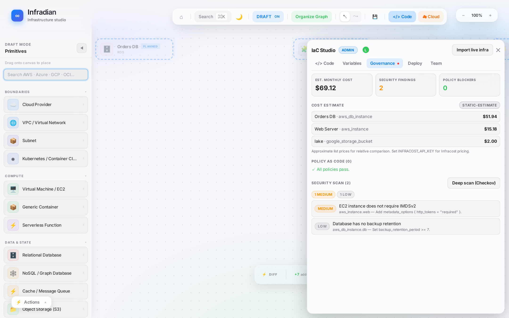 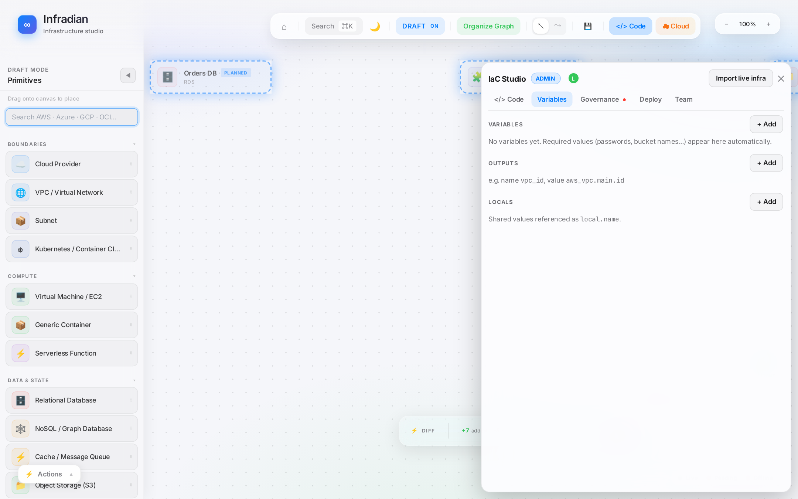</p>
<p align="center">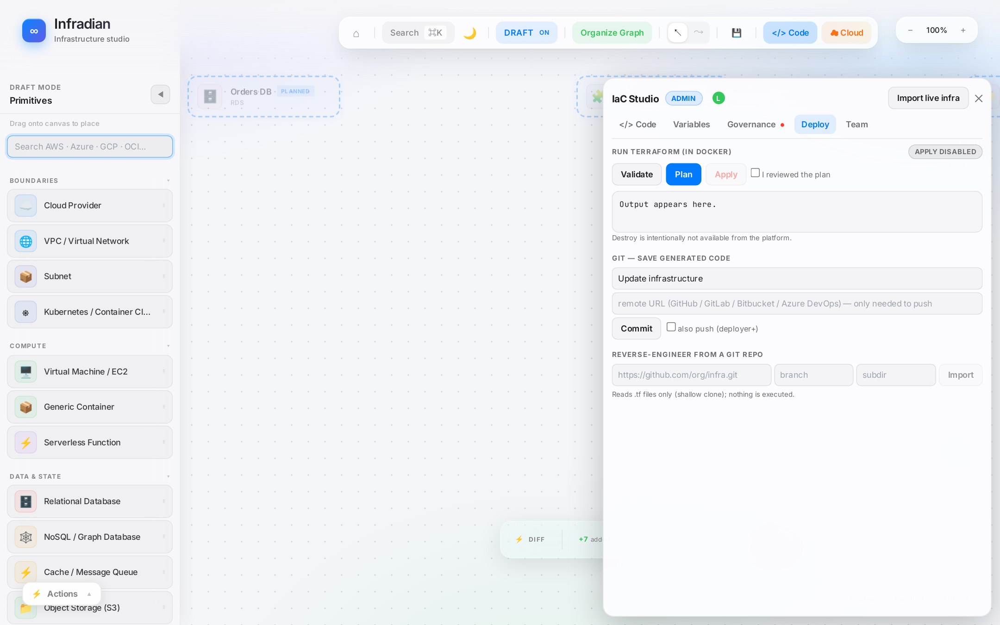 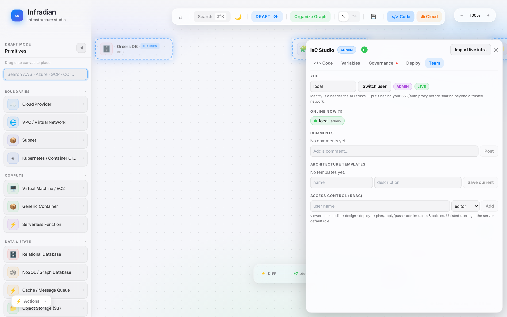</p>
<p align="center"><em>Cost + policy + security findings · variables/outputs · plan/apply/Git/import · presence, comments, templates, RBAC.</em></p>

<p align="center">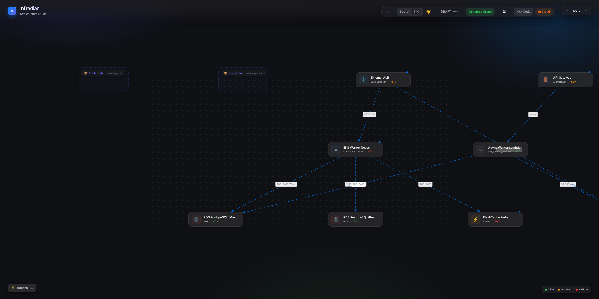<br><em>Dark mode.</em></p>

---

## Architecture

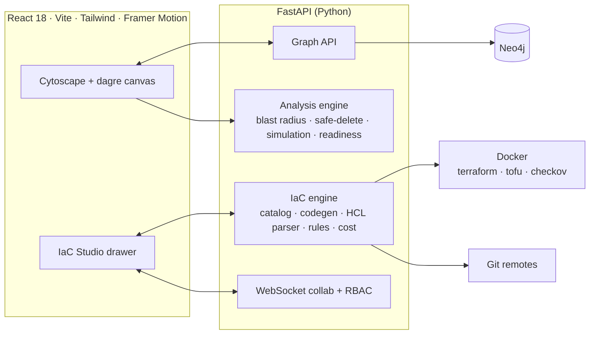

### Engineering highlights
- **Analysis engine** (`backend/app/analysis/engine`) — weighted Dijkstra blast radius, counterfactual removal simulation (broken / degraded / unaffected), safe-delete checks, confidence scoring, architecture readiness and resilience scores, ranked "top actions". Covered by 36 unit tests.
- **Bidirectional IaC sync** (`backend/app/iac`) — a deterministic generator (same canvas → byte-identical code) and an HCL parser (python-hcl2) that map back to the graph, preserving node identity and *your* resource names. Round-trip stability is tested.
- **Dynamic linking** — containment and drawn edges become real references (`subnet_id = aws_subnet.app.id`); required-but-missing values (passwords, bucket names) become typed, sensitive variables automatically.
- **Safe-by-default deploys** — apply is off unless the server opts in, needs explicit confirmation, a saved plan and zero policy denials; **no destroy path exists**. Git import is read-only (`.tf` files only, nothing executed).
- **Real-time collaboration** — per-workspace WebSocket rooms (presence + last-writer-wins graph sync) with role enforcement on the server.

### The platform around it
A separate small service and the delivery pipeline show the operational side — see **[docs/PLATFORM.md](docs/PLATFORM.md)**:

| Area | What's there |
|---|---|
| IaC | Terraform for **VPC + EKS + ECR**, remote state in **S3 with native locking**, kind config for local dev |
| App | Go service + PostgreSQL, Prometheus metrics, distroless image, Helm chart |
| CI | GitHub Actions: test → build → **Trivy** scan → push to **ECR** → bump GitOps tag |
| GitOps | **ArgoCD** app-of-apps — deploy by commit |
| Observability | Prometheus, Grafana, Loki; **2 SLOs** (99.5% availability, p95 < 300 ms) with burn-rate alerts |
| Automation | `pod_doctor.py` finds/restarts unhealthy pods; k6 load test; game-day scripts; runbook |

---

## Tech stack

| Layer | Technologies |
|---|---|
| Frontend | React 18, Vite 4, Tailwind CSS, Framer Motion, Cytoscape.js (+ dagre) |
| Backend | Python, FastAPI, Pydantic v2, python-hcl2, WebSockets, Typer CLI |
| Data | Neo4j (graph), JSON workspaces |
| IaC | Terraform / OpenTofu, S3 remote state, Checkov (optional), Infracost (optional) |
| Platform | Go, PostgreSQL, Docker, Helm, ArgoCD, kind/EKS, GitHub Actions, Trivy |
| Observability | Prometheus, Alertmanager, Grafana, Loki |
| Testing | pytest (48 backend tests), Go tests, pod-doctor tests, Playwright (screenshots) |

## Try it

```bash
git clone https://github.com/rvraghav2000/infradian.git && cd infradian
docker compose up            # Neo4j + FastAPI (:8000) + React (:3000)
```
Open <http://localhost:3000>. If Neo4j is empty or down, the API falls back to the bundled demo graph.
Run the tests: `cd backend && pip install -r requirements.txt pytest httpx && pytest app/analysis/engine tests/test_iac.py`.
Regenerate the screenshots/GIF in this README: `docs/capture/run.sh` (Docker + a running app).

## Repository map
```
frontend/           React app (canvas, panels, IaC Studio)        backend/app/analysis/   impact engine
backend/app/iac/    codegen · parser · rules · cost · git · collab  backend/app/api/        REST routes
services/           Go inventory service                            infra/terraform/        VPC · EKS · state bucket
deploy/ gitops/     Helm chart · ArgoCD apps                        observability/          SLO rules · dashboards
tools/ chaos/       pod_doctor · k6 · game-day                       docs/                   platform, IaC studio, runbook
```

## Honest notes
- **Demo data.** The map shows a bundled sample estate (with simulated load metrics), not a connected cloud account. Cloud connectors (AWS/Azure/GCP) and Terraform-state import exist but need your credentials.
- **Not verified end-to-end here:** a live `terraform apply`, Checkov/Infracost runs, Git push/remote import, and the Kubernetes/ArgoCD stack were not exercised against real infrastructure. The Helm chart lints, Terraform validates, and the Go/Python tests pass.
- **RBAC is authorization, not authentication** — it trusts a user header, so put it behind SSO before sharing. Collaboration is single-process and last-writer-wins.
- The post-incident write-up is a template ([docs/postmortems](docs/postmortems/TEMPLATE.md)) until a real game day is run.

## Roadmap
Real cloud discovery as the default data source · OIDC auth · CRDT-based collaboration · more resource generators (Azure VM networking, GCP Cloud SQL) · a recorded chaos game day and postmortem.
