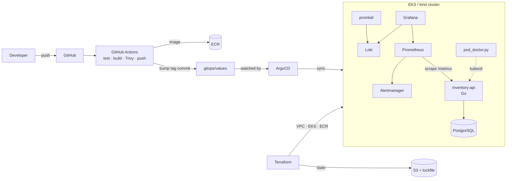

# Platform engineering around Infradian

The delivery platform: Terraform, Kubernetes, CI, GitOps, observability, SLOs, chaos tooling.



## IaC Studio (in the app: **</> Code**)
(see also [IAC_STUDIO.md](IAC_STUDIO.md))
Design on the canvas, get Terraform/OpenTofu, and ship it — all from the Infradian UI.

| Capability | How it works |
|---|---|
| Multi-cloud canvas | Palette lists AWS, Azure, GCP and OCI resources (`backend/app/iac/catalog.py`); one workspace can mix them |
| Real-time code generation | Canvas → `POST /api/v1/iac/generate` → `versions.tf`, `providers.tf`, `main.tf`, `variables.tf`, `outputs.tf`. Terraform or OpenTofu toggle |
| Bidirectional sync | Edit the code and the canvas updates after you stop typing (`/iac/parse`, python-hcl2); nodes keep identity/position and your resource names |
| Dynamic linking | Containment (VPC ⊃ subnet) and drawn edges (instance → security group) become real references (`subnet_id = aws_subnet.app.id`); missing required values become variables automatically |
| Variables / locals / outputs | **Variables** tab, persisted with the workspace |
| Reverse engineering | Paste/edit `.tf`, **Import from Git repo** (shallow clone, reads `.tf` only), **Import live infra** |
| Plan / apply | **Deploy** tab runs `init/validate/plan/apply` in Docker (`hashicorp/terraform` or OpenTofu). Apply needs `INFRADIAN_ALLOW_APPLY=1`, an explicit confirm, a saved plan and no policy denials. **No destroy** |
| Git | Commit generated code to a per-workspace repo; optional push to any https/ssh remote (GitHub, GitLab, Bitbucket, Azure DevOps) |
| Cost | Static price table by default; real pricing via Infracost image when `INFRACOST_API_KEY` is set (untested here) |
| Security + policy | Built-in guardrails + policy-as-code (`data/policies.json`, defaults in `rules.py`), plus optional full Checkov run in Docker |
| Collaboration | WebSocket rooms per workspace: presence + live graph sync, comments, template catalog |
| RBAC | viewer < editor < deployer < admin (`data/rbac.json`; `INFRADIAN_DEFAULT_ROLE`, default `admin` for local dev) |

Caveats: RBAC trusts the `X-Infradian-User` header (no authentication — put it behind SSO/an auth proxy);
collaboration is last-writer-wins on a single API process; Azure VMs/Cloud SQL etc. need extra attributes before a real apply.
Tests: `cd backend && venv/bin/python -m pytest tests/test_iac.py`.

## Layout
| Path | What |
|---|---|
| `infra/terraform/bootstrap` | One-time S3 state bucket (versioned, encrypted, native locking) |
| `infra/terraform/aws` | VPC + EKS + ECR, remote state in S3 |
| `infra/terraform/local-kind` | kind cluster config (local stand-in for EKS) |
| `services/inventory-api` | Go service + PostgreSQL, `/metrics`, `/healthz`, `/readyz`, Dockerfile (distroless) |
| `deploy/helm/inventory-api` | Helm chart (app, Postgres, PDB, ServiceMonitor) |
| `.github/workflows/ci.yml` | test → build → **Trivy** → push to **ECR** → commit new tag to `gitops/` |
| `gitops/` | ArgoCD app-of-apps: app, kube-prometheus-stack, Loki, observability config |
| `observability/` | SLO recording rules + alerts, Grafana dashboard |
| `tools/pod_doctor.py` | Detects unhealthy pods; reports or restarts them |
| `chaos/` | k6 load test + game-day scripts |
| `docs/` | Runbook, postmortem template |
| `backend/`, `frontend/` | The original Infradian app |

## SLOs
| SLO | Target | Alerts |
|---|---|---|
| Availability | 99.5% non-5xx over 30d (0.5% budget) | `InventoryAvailabilityBurnFast` (14.4× · page), `…BurnSlow` (6× · ticket), `InventoryDown` |
| Latency | p95 < 300 ms | `InventoryLatencyP95High` |

## Run it locally (kind)
```bash
# Only Docker is needed on the host. kind, kubectl, helm, trivy, terraform and k6 all run
# inside the toolbox image (tools/toolbox) via the scripts/tb wrapper.
scripts/local-up.sh            # kind + ArgoCD + app-of-apps
scripts/tb python3 tools/pod_doctor.py -n inventory
scripts/tb k6 run --env BASE_URL=http://host.docker.internal:8080 chaos/loadtest.js
scripts/tb trivy image inventory-api:dev
docker compose up                      # original app: Neo4j + FastAPI + React (:3000)
docker compose --profile platform up   # + inventory-api and its Postgres (:8080)
chaos/gameday.sh kill-pod      # | db-overload | bad-deploy | restore
```
ArgoCD syncs from the repo's `main` branch, so push your commits first. For kind, the image is
side-loaded (`inventory-api:dev`); for EKS, CI pushes to ECR and rewrites `gitops/values/inventory-api.yaml`.

## Run it on AWS
```bash
# prefix with scripts/tb to run terraform in the toolbox (pass AWS creds via env)
cd infra/terraform/bootstrap && terraform init && terraform apply -var state_bucket_name=infradian-tfstate-<acct>
cd ../aws && cp backend.hcl.example backend.hcl   # edit bucket
terraform init -backend-config=backend.hcl && terraform apply
```
Set the repo secret `AWS_ROLE_ARN` (GitHub OIDC role with ECR push) for CI.

## Tearing down
Not automated here on purpose. When you're done with AWS, from `infra/terraform/aws` run
`terraform destroy` (EKS + NAT cost money). The state bucket has `prevent_destroy`; remove that
lifecycle block before destroying `bootstrap`.

## Status / still to do
- Postmortem: `docs/postmortems/TEMPLATE.md` is ready; the real one needs the game-day run on a live cluster.
- Demo GIF: record after the game day and drop it at `docs/demo.gif`.
- `kind`, `helm`, `trivy` and an AWS account are needed to exercise the cluster-side pieces; here only
  the Go tests, Docker build, `helm lint`, `terraform validate` and `pod_doctor` tests were run.
